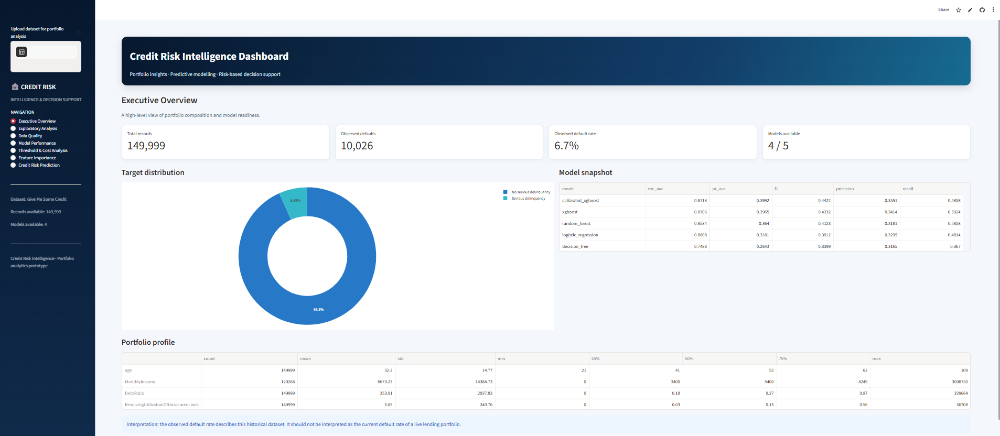
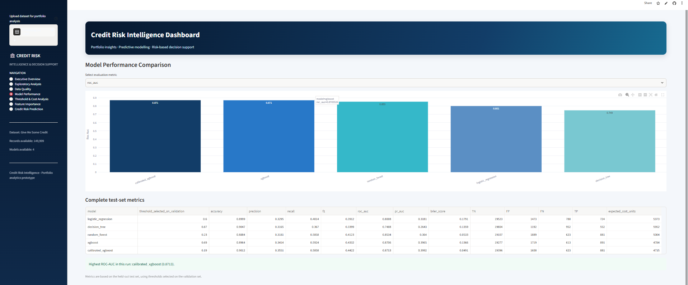
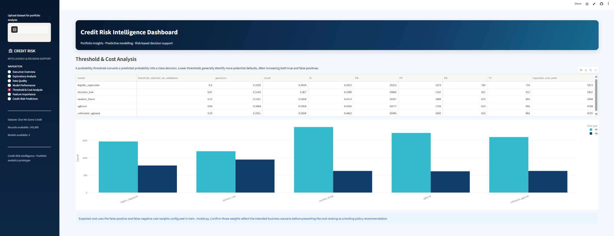
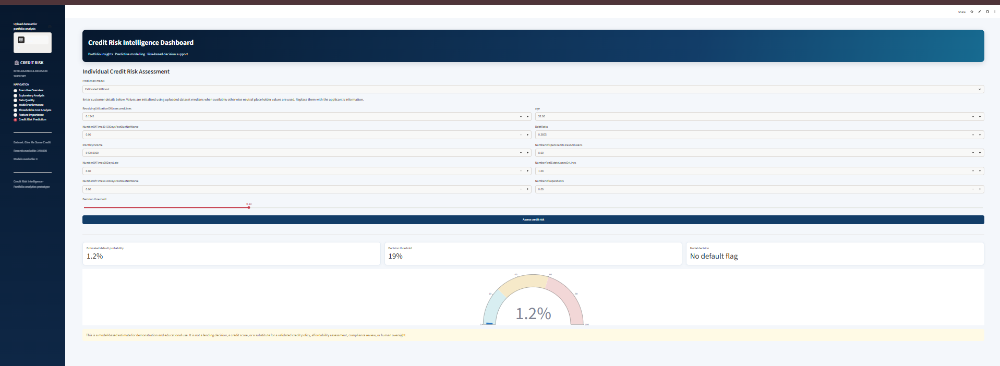

# 🏦 Credit Risk Intelligence Dashboard

### An Interactive Machine Learning Platform for Credit Risk Assessment and Default Prediction

[](https://credit-risk-intelligence-dashboard-ruzv35highkgsbytkzzdff.streamlit.app/)
[](https://www.python.org/)
[](https://scikit-learn.org/)
[](https://streamlit.io/)

**🚀 Live Application:** [Credit Risk Intelligence Dashboard](https://credit-risk-intelligence-dashboard-ruzv35highkgsbytkzzdff.streamlit.app/)

---

## 📌 Project Overview

Credit risk assessment is a critical process in the financial industry, enabling lending institutions to evaluate the probability of borrowers defaulting on their financial obligations.

This project develops an interactive **Credit Risk Intelligence Dashboard** using Python and machine learning to analyse borrower characteristics, predict credit default risk, compare classification models, and evaluate prediction thresholds from a business-cost perspective.

The application integrates statistical analysis, exploratory data analysis, machine learning, model evaluation, and interactive visualisation into a single platform.

The primary objective is to demonstrate how predictive analytics can support data-driven credit risk assessment and lending decisions.

## 🎯 Project Objectives

- Perform exploratory data analysis to understand borrower characteristics and credit risk patterns.
- Investigate missing values, outliers, and class imbalance.
- Develop and compare multiple machine learning classification models.
- Evaluate models using appropriate classification and discrimination metrics.
- Analyse classification thresholds to understand the trade-off between false positives and false negatives.
- Estimate the business cost associated with different classification decisions.
- Develop an interactive dashboard for exploring model performance and generating credit risk predictions.

## 📂 Dataset Description

**Dataset:** Give Me Some Credit

**Source:** Kaggle – Give Me Some Credit competition.

The dataset contains approximately 150,000 observations and 12 columns, including borrower-related financial and demographic variables.

The target variable represents whether an individual experienced serious financial delinquency.

The dataset is used to investigate borrower characteristics and build predictive models for credit default risk.

**Note:** The original dataset is not included in this repository. Users should obtain it from Kaggle and follow the dataset's applicable terms of use.

## 🛠️ Technology Stack

| Category | Tools and Technologies |
|---|---|
| Programming | Python |
| Data manipulation | Pandas, NumPy |
| Data visualisation | Matplotlib, Seaborn, Plotly |
| Machine learning | Scikit-learn, XGBoost |
| Model persistence | Joblib |
| Statistical analysis | Descriptive statistics, correlation analysis |
| Dashboard development | Streamlit |
| Deployment | Streamlit Community Cloud |
| Version control | Git and GitHub |

## ⚙️ Project Workflow

The project follows an end-to-end machine learning workflow:

1. **Data Understanding:** Examine the dataset structure, variables, and target distribution.
2. **Exploratory Data Analysis:** Analyse distributions, relationships, correlations, and outliers.
3. **Data Preprocessing:** Handle missing values and prepare features for modelling.
4. **Model Development:** Train multiple classification algorithms.
5. **Model Evaluation:** Compare predictive performance using classification metrics and ROC-AUC.
6. **Threshold Analysis:** Examine different classification thresholds and their associated business costs.
7. **Deployment:** Integrate the trained models into an interactive Streamlit dashboard.

## 🤖 Machine Learning Models

Five classification models were evaluated:

1. Logistic Regression
2. Decision Tree
3. Random Forest
4. XGBoost
5. Calibrated XGBoost

The models were compared to understand the performance differences between traditional statistical classification approaches and ensemble learning methods.

## 📊 Model Performance Comparison

The following results were obtained from the model evaluation:

| Model | ROC-AUC | Precision | Recall | F1-Score |
|---|---:|---:|---:|---:|
| Logistic Regression | 0.8008 | 0.3295 | 0.4814 | 0.3912 |
| Decision Tree | 0.7488 | 0.3165 | 0.3670 | 0.3399 |
| Random Forest | 0.8534 | 0.3181 | 0.5858 | 0.4123 |
| XGBoost | 0.8706 | 0.3414 | 0.5924 | 0.4332 |
| Calibrated XGBoost | **0.8713** | **0.3551** | 0.5858 | **0.4422** |

**Key observation:** Calibrated XGBoost achieved the highest ROC-AUC and F1-score among the evaluated models. XGBoost and Random Forest also demonstrated stronger recall compared with Logistic Regression and Decision Tree.

These results highlight the importance of evaluating models using multiple performance metrics rather than relying on accuracy alone.

## 💰 Threshold and Cost Analysis

In credit risk modelling, the default classification threshold of 0.5 may not always be appropriate.

A lower threshold can help identify more potentially high-risk borrowers, but it may also increase false-positive predictions.

This project includes threshold analysis to investigate:

- Precision and recall trade-offs.
- False-positive and false-negative counts.
- Expected classification cost.
- Model-specific optimal classification thresholds.

The analysis provides a business-oriented perspective on selecting prediction thresholds for credit risk assessment.

## 📸 Dashboard Preview

### 1. Executive Overview



### 2. Model Performance



### 3. Threshold and Cost Analysis



### 4. Credit Risk Prediction



## 🌐 Interactive Dashboard Features

The Streamlit application contains seven major sections:

| Section | Description |
|---|---|
| Executive Overview | Summary of the dataset and key project insights |
| Exploratory Analysis | Interactive exploration of borrower characteristics |
| Data Quality | Examination of missing values and data quality |
| Model Performance | Comparison of machine learning models |
| Threshold & Cost Analysis | Evaluation of classification thresholds and expected costs |
| Feature Importance | Identification of influential predictive variables |
| Credit Risk Prediction | Interactive borrower-level credit risk prediction |

**Explore the application:** [Launch Live Dashboard](https://credit-risk-intelligence-dashboard-ruzv35highkgsbytkzzdff.streamlit.app/)

## 📁 Repository Structure

```text
Credit-Risk-Intelligence-Dashboard/
│
├── app.py
├── train_model.py
├── requirements.txt
├── README.md
│
├── models/
│   ├── calibrated_xgboost.joblib
│   ├── xgboost.joblib
│   ├── decision_tree.joblib
│   └── logistic_regression.joblib
│
├── outputs/
│   ├── model_metrics.csv
│   ├── threshold_analysis.csv
│   ├── selected_thresholds.json
│   ├── test_predictions.csv
│   └── training_metadata.json
│
└── screenshots/
    ├── executive_overview.png
    ├── model_performance.png
    ├── threshold_analysis.png
    └── credit_prediction.png
```

**Note:** The Random Forest model was evaluated during model development, but its large model file was not included in the repository due to GitHub's individual file-size limit.

## 💻 Installation and Setup

Follow these steps to run the project locally.

### 1. Clone the repository

```bash
git clone https://github.com/boseadityabarna-beep/Credit-Risk-Intelligence-Dashboard.git
```

### 2. Navigate to the project directory

```bash
cd Credit-Risk-Intelligence-Dashboard
```

### 3. Create a virtual environment

```bash
python -m venv venv
```

Activate it on Windows:

```bash
venv\Scripts\activate
```

### 4. Install dependencies

```bash
pip install -r requirements.txt
```

### 5. Run the Streamlit application

```bash
streamlit run app.py
```

The application will open in your default browser.

**Dataset:** Obtain the Give Me Some Credit dataset separately from Kaggle if required by the application's data-upload workflow.

## 📈 Key Findings

- Ensemble learning models demonstrated stronger ROC-AUC performance than Logistic Regression and Decision Tree in this evaluation.
- Calibrated XGBoost achieved the best overall ROC-AUC and F1-score.
- Recall and precision involve a trade-off that is particularly important in imbalanced credit risk classification.
- Classification threshold selection can influence the number of false-positive and false-negative predictions.
- An interactive dashboard makes model evaluation and prediction outputs more accessible to users.

## ⚠️ Limitations

- Model performance depends on the quality and representativeness of the available dataset.
- Predictions are based on historical patterns and may not capture changing borrower behaviour or economic conditions.
- Classification thresholds and expected costs depend on the assumptions used in the analysis.
- The dashboard is intended for educational and analytical purposes and should not be treated as a standalone system for actual lending decisions.

## 🔮 Future Enhancements

- Integrate SHAP-based explainability for individual borrower predictions.
- Explore additional model calibration and validation techniques.
- Introduce model monitoring and data drift detection.
- Incorporate newer and more diverse credit datasets.
- Extend the application with additional risk segmentation and reporting capabilities.

## 👩‍💻 Author

**Adityabarna Bose**

Master of Statistics (MSTAT)  
CHRIST (Deemed to be University), Bengaluru

**Areas of Interest:** Statistical Modelling | Machine Learning | Data Analytics | Predictive Modelling

---

⭐ If you find this project interesting, feel free to explore the repository and interact with the live dashboard!
